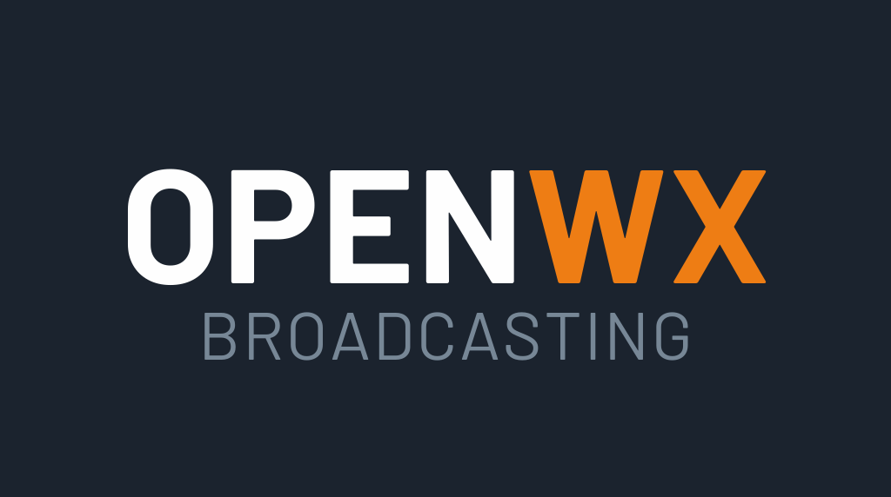

<p align="center"></p>

# OpenWX Broadcasting

A weather studio for community stations: live radar maps, on-air graphics, shows and severe
weather coverage, built on free public data from NOAA and the National Weather Service. Made for
small teams, volunteers and weather enthusiasts who want professional-looking coverage without a
TV station's budget or an IT department.

> **Status: early alpha.** Expect rough edges, and please [report what you find](https://github.com/jdc20181/OpenWXBroadcasting/issues).
>
> OpenWX is **not an official warning source**. For life-safety decisions, follow the National
> Weather Service and your local emergency management.

## Download

Get the latest version from **[Releases](https://github.com/jdc20181/OpenWXBroadcasting/releases)**.
Pick the file for your computer:

| Your computer | Download | Status |
|---|---|---|
| **Windows** 10 or 11 (64-bit) | `OpenWXBroadcasting-Windows-V<version>-<build>.exe` | Supported |
| **Linux** (64-bit; Ubuntu, Debian, Fedora and most others) | `OpenWXBroadcasting-Linux-V<version>-<build>.AppImage` or `.deb` | Coming soon |
| **macOS** 11 or newer (Apple Silicon) | `OpenWXBroadcasting-MacOS-V<version>-<build>.dmg` | Coming soon, best effort |

**Windows:** run the installer. No admin rights needed. The app checks for updates and installs
them for you.

**Linux:** make the AppImage executable and run it, or install the `.deb`. When a new version is
out, the app tells you and opens the download page.

**macOS:** open the `.dmg` and drag OpenWX into Applications. The first time, macOS says it can't
check the app (it isn't signed with a paid Apple developer account): open **System Settings >
Privacy & Security**, scroll down and click **Open Anyway**. When a new version is out, the app
tells you and opens the download page.

### First start

A setup wizard asks for your station's name, a contact for the National Weather Service, your
state, your counties and your main city. That's all: the weather data backend runs inside the app.
Change anything later in **Settings**.

## What it does

- **Map Studio:** live radar, satellite, warnings and watches, SPC severe outlooks, drought,
  earthquakes, river gauges and NOAA computer models (HRRR and GFS), with storm tracking and
  your own town labels.
- **Graphics Studio:** hundreds of ready-made on-air graphics (forecasts, current conditions,
  records, outlooks, history, explainers, holidays), each in full screen, vertical and square
  sizes for TV and social media. Your station's name, colours and logo go on every one.
- **Show Builder:** put maps and graphics in a rundown, add music, run it live or let it play
  itself, and export it as an MP4 video.
- **Severe Weather Mode:** warnings take over the screen the way the NWS issues them, with
  alert tones, a crawl and county lists.
- **Winter Studio:** snow and ice maps, model comparisons and forecast zones you draw yourself.
- **Program output:** a clean full-screen feed for a second screen, a capture card or OBS.
- **Updates and bug reports** from inside the app.

## Screenshots

<!-- Screenshots go in docs/screenshots/ (map-studio.png, graphics-studio.png, show-builder.png,
severe-mode.png) and are linked here once taken from a release build. -->

_Coming with the next release._

## Data

OpenWX reads free public data straight from the National Weather Service, NOAA's prediction
centers and model files, the U.S. Drought Monitor, USGS and other public agencies, and sends your
station's contact with each request, as the NWS asks. The full list is in
[How OpenWX works](docs/how-it-works.md#data-sources).

## Licence

[OpenWX License 1.0](LICENSE). Free to use, including for businesses and pages that earn money
from their coverage. Free to change and share; anything you share keeps the same licence and its
source. Selling the software itself needs a Commercial Waiver (a donation of US $500 or more).
Third-party parts keep their own licences ([docs/licensing.md](docs/licensing.md)).

---

## For developers

### Building from source

Latest stable Rust (`rustup update stable`), then:

```bash
git lfs install                     # the bundled CC0 music uses Git LFS
cargo run -p openwx-broadcaster     # the studio
cargo test --workspace
```

Prefer a terminal for setup? `openwx setup` asks the same questions as the wizard. How the parts
fit together: [docs/how-it-works.md](docs/how-it-works.md). Installers and signed updates:
[installer/README.md](installer/README.md). Contributing: [CONTRIBUTING.md](CONTRIBUTING.md).

### Project documents

| | |
|---|---|
| [CONTRIBUTING.md](CONTRIBUTING.md) | How to help, ground rules, building, pull requests |
| [SECURITY.md](SECURITY.md) | Reporting vulnerabilities privately; how OpenWX is built to be safe |
| [CODE_OF_CONDUCT.md](CODE_OF_CONDUCT.md) | How we treat each other |
| [SUPPORT.md](SUPPORT.md) | Where to get help |
| [CHANGELOG.md](CHANGELOG.md) | Release notes |
| [PLAN.md](PLAN.md) | Road map and release gates |
| [docs/how-it-works.md](docs/how-it-works.md) | The studio, the relay and the CLI; data sources; design notes |
| [docs/](docs/) | Design docs: backend, setup wizard, modularity, themes, licensing. Release notes in `docs/releases/` |
| [brand/](brand/BRAND.md) | Logo, icon and colours |
